# 🎟️ Vibetix - Online Ticket Booking System

> Vibetix is an online event and concert ticket booking platform designed to streamline transactions between event organizers and ticket buyers. 

This system was developed to solve inefficient manual ticket booking processes by providing an integrated, fast, secure, and modern digital solution. With Vibetix, users can seamlessly explore events, process simulated payments, and instantly receive digital e-tickets within minutes.

The web application is built using the **MERN Stack** ecosystem and **TypeScript** to ensure strict type safety, code maintainability, and high application scalability.

🔗 **[Live Demo](https://frond-end-vibetix.vercel.app)** | 🔗 **[Backend API Repository](https://github.com/Yudhadp13/back-end-vibetix)**

---

## 💻 Tech Stack
- **Frontend:** React.js, TypeScript
- **Backend API:** Node.js, Express.js
- **Database:** MongoDB

---

## ✨ Key Features

### 👤 User Features
Users can explore various music concerts, book tickets, and access digital tickets through a highly responsive and user-friendly interface.

- **Home & Event Exploration:** Displays featured events, an interactive search bar, and category filters.
  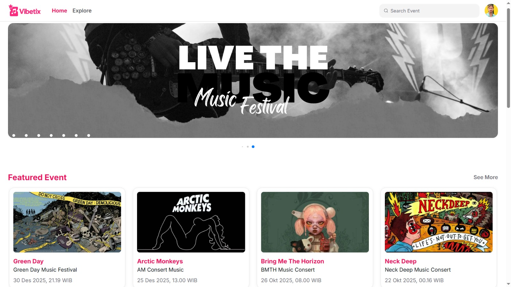
  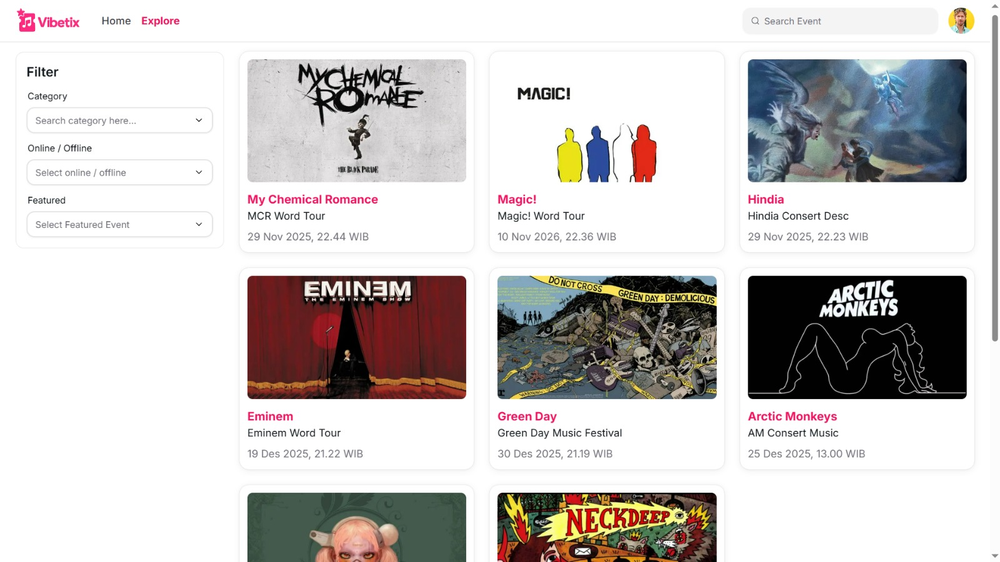

- **User Authentication:** Secure account registration and login system.
  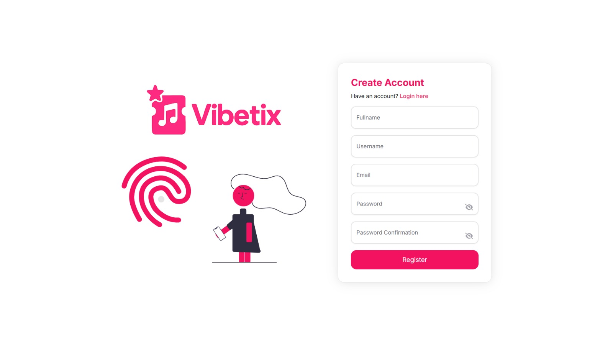
  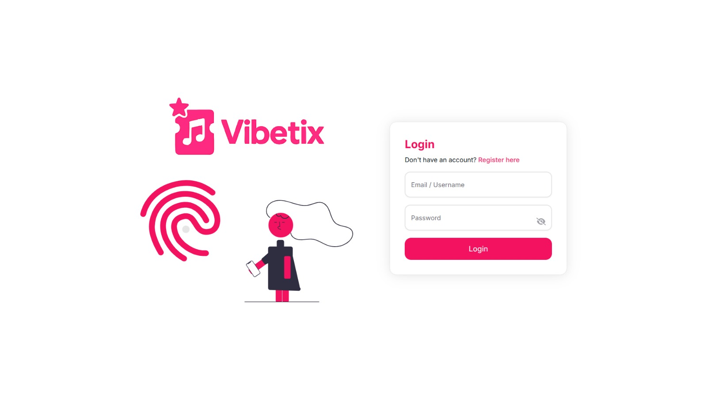

- **Checkout & Payment:** Streamlined ticket purchasing workflow equipped with simulated payment gateways (GoPay, Virtual Accounts, Credit Cards).
  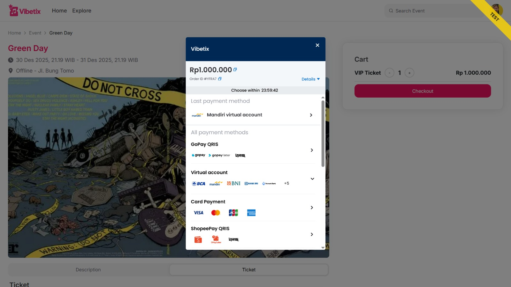

- **Transaction History & QR E-Ticket:** Users can track order details and instantly access their digital e-ticket via a QR code upon successful payment.
  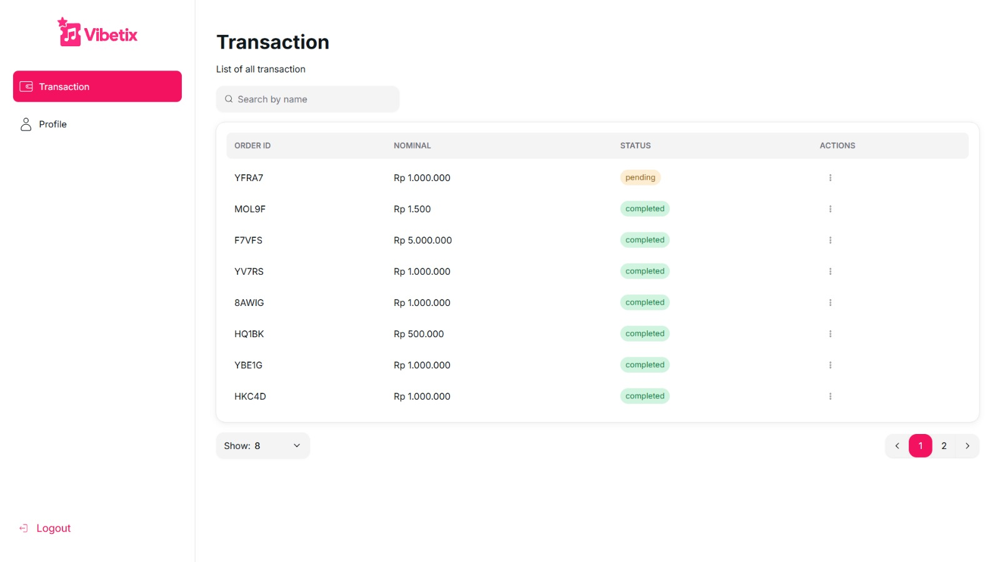
  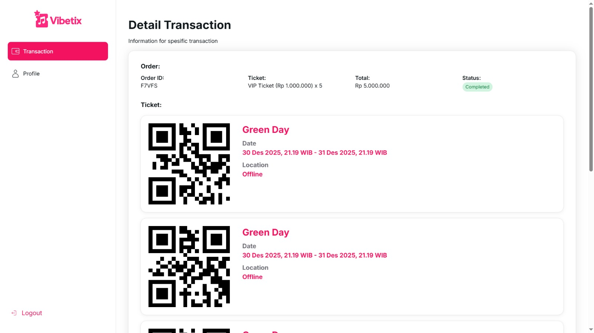

---

### 🛡️ Admin Dashboard
Administrators have full access rights via a dedicated dashboard to manage the platform's core operational data.

- **Event Management:** Admins can seamlessly Create, Read (view details), Update, and Delete (CRUD) concerts, events, and ticket availability.
  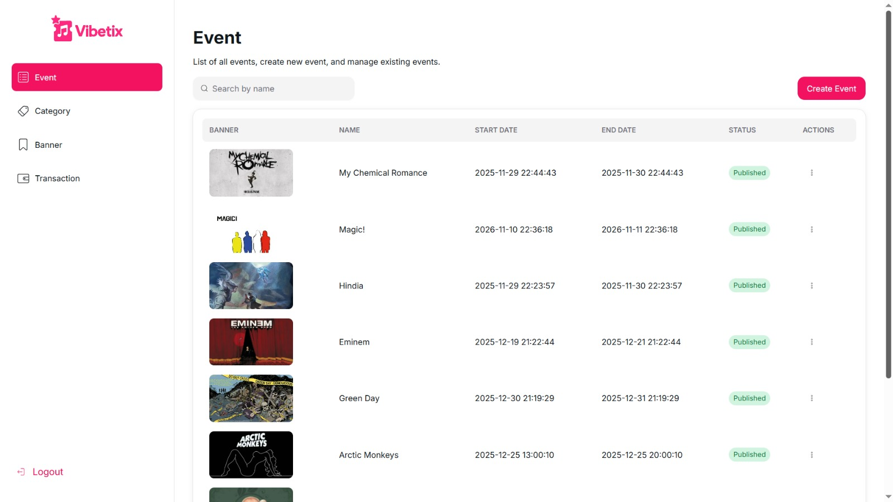

- **Category & Banner Management:** Complete control over music genre categories (e.g., Jazz, Pop, Rock) and dynamic promotional banners displayed on the homepage.
  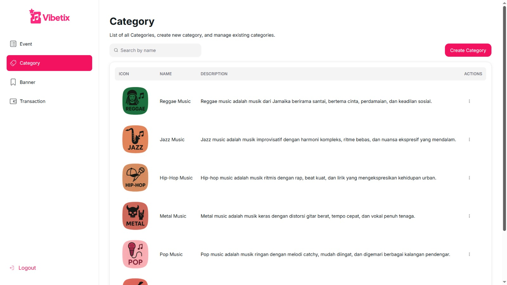
  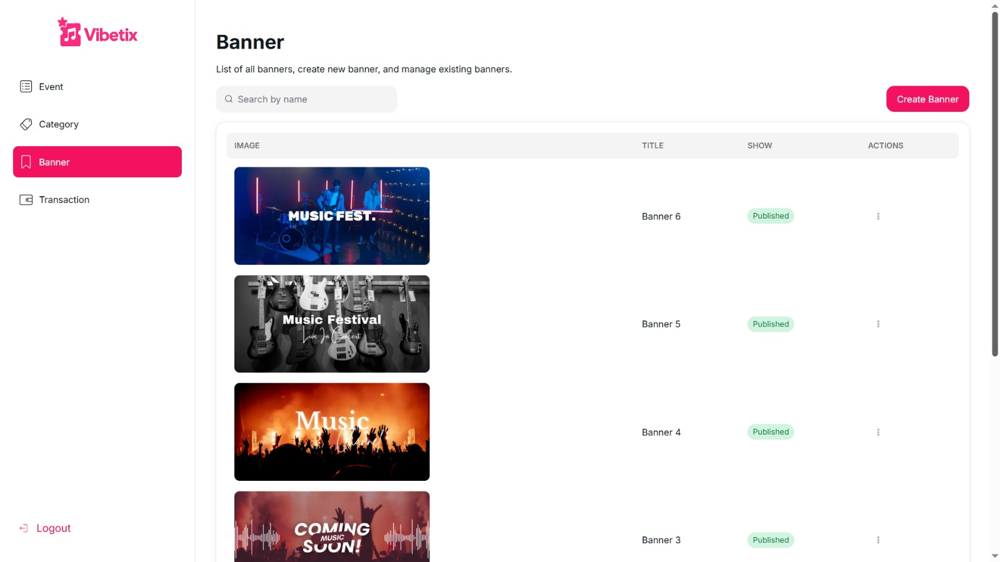

- **Transaction Management:** Real-time monitoring of all incoming user transactions and their current payment statuses.
  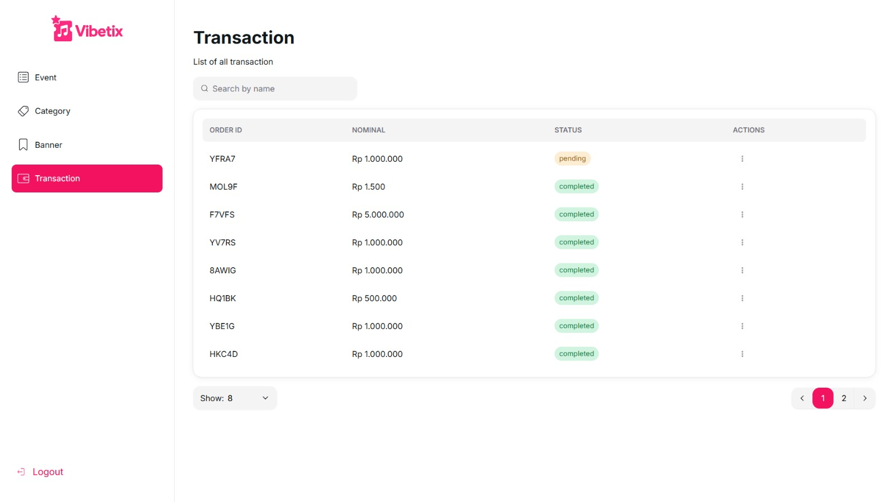

---

## 📂 Project Architecture
This project adopts a decoupled Client-Server architecture and is divided into two primary repositories:
- **Frontend Repository:** [https://github.com/Yudhadp13/frond-end-vibetix](https://github.com/Yudhadp13/frond-end-vibetix)
- **Backend API Repository:** [https://github.com/Yudhadp13/back-end-vibetix](https://github.com/Yudhadp13/back-end-vibetix)

---

## 🚀 Getting Started (Local Development)

1. **Clone this repository:**
   ```bash
   git clone https://github.com/Yudhadp13/frond-end-vibetix.git

2. **Navigate to the project directory:**
   ```bash
   cd vibetix-frontend

3. **Install dependencies:**
   ```bash
   npm install

4. **Set up Environment Variables:**
   Create a .env.local file in the root directory and configure your backend API URL:
   ```env
   NEXT_PUBLIC_API_URL=http://localhost:5000

5. **Run the development server:**
   ```bash
   npm run dev

6. **Open http://localhost:3000 with your browser to see the result.**

---

Developed as a Capstone Project by the Informatics Engineering Team, Universitas Muhammadiyah Tangerang (2025).